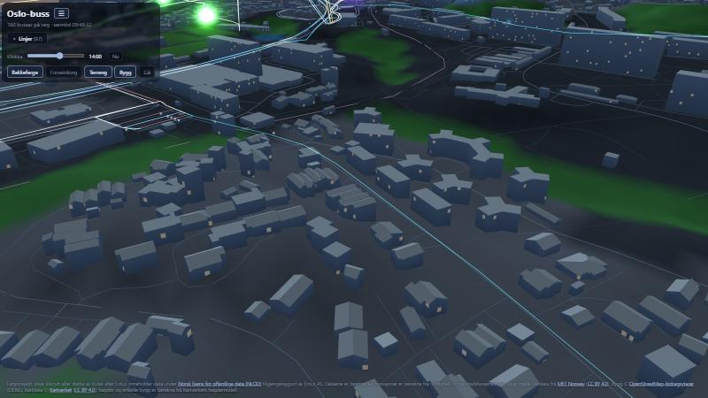

# oslo-buss

[](https://github.com/slish/oslo-buss/actions/workflows/ci.yml)

Fanprosjekt: **Ruter-bussar i Oslo og Bærum som lyspunkt og bussmodellar i eit 3D-kart**, med sanntid frå Entur, Kartverket-terreng og -bygg, døgnrytme og vêr. Du kan sjå heile nettet frå oven, setje deg på ein buss, eller stå på bakken og gå rundt.

**Live:** https://oslo-buss.oslo-buss.workers.dev



Alle 97 bussliner som køyrer i Oslo og Bærum er med (`DEFAULT_LINES` i `scripts/build-timetable.ts`).

## Kva du kan gjere

- **Sjå nettet:** Kvar buss er eit lysande punkt i fargen til linja. Nærare enn ca. 2,5 km går punktet over i ein 3D-bussmodell. Dra for å flytte, scrollhjul/knip for å zoome mot peikaren, høgre eller midtre knapp (eller Shift + dra), eller to fingrar, for å rotere og vippe.
- **Klikk:** Ein buss, ein haldeplass eller ei linje gir info: neste avgangar med forseinking, linjenamn, tal turar i dag, og kor mange bussar som er på vegen no.
- **Legenda:** Skru linjer av og på (eller «Vis alle» / «Skjul alle»). Ho kan foldast saman, og er foldd frå start på mobil.
- **Sitt på bussen:** Vel ein buss og trykk «Sitt på bussen». Du ser vegen frå førarsetet, kan sjå deg rundt, og kjem av med «Gå av bussen» (eller Esc). Linjefargar og haldeplassprikkar blir skjulte for å gi mindre støy.
- **Gå rundt i førsteperson:** Knappen **Gå** eller tasten **G** set deg på bakken. `W A S D` eller piltastar går, `Shift` spring, musa ser deg rundt (pointer lock; dra på berøringsskjerm), `B` skrur bygningskollisjon av og på, `Esc` går ut. `Alt` + dobbeltklikk eller `Enter` set deg ned ved peikaren.
- **Forseinkingskart:** Knappen **Forseinking** fargar bussar og linjer frå blått (før tida) og grønt (i rute) via gult og oransje til raudt (10+ minutt forseinka). Bussar utan målt forseinking er grå.
- **Døgnrytme:** Sol og måne står der dei faktisk gjer, etter klokka og datoen, med riktig månefase, stjerner, skyer og ein himmel som skiftar frå natt via skumring til dag. Kartet blir lyst opp etter timen, og bygningsvindauga lyser når det er mørkt. Glidaren **Klokka** viser ein annan time i dag, og «No» går tilbake til klokka.
- **Vêr:** Skydekke og nedbør frå MET Norway styrer himmelen. Regn fell som strekar, snø som svaiande flak, og i regn blir det dis. **Snødekket på bakken** følgjer temperaturen: nesten ingenting ved 0 °C og kvitt ved −10 °C (vatn blir ikkje kvitt, asfalt er brøyta).

### Adresseparametrar

| Parameter | Verknad |
|---|---|
| `?kart=kartverket` | Faktiske fargar på bakken (skog, vatn, tettstad) i staden for mørk bakgrunn. Same som knappen **Bakkefarge** |
| `&terreng=1` | Terrenget følgjer høgdemodellen. Same som knappen **Terreng** (verkar òg utan bakkefarge) |
| `&bygg=0` | Skjuler bygga. Same som å skru av knappen **Bygg** |
| `&forseinking=1` | Forseinkingskartet. Same som knappen **Forseinking** |
| `&tid=22:30` | Sett timen på døgnet (i dag), til dømes for å sjå natt midt på dagen |
| `&vaer=klart\|sky\|regn\|sno\|kulde` | Set vêret for hand (`kulde` er −12 °C), til å teste når det røynlege vêret er kjedeleg |

## Kjøre lokalt

```bash
npm install
npm run timetable   # lastar ned Entur sin GTFS for Ruter og lagar public/data/timetable.json (alle liner, ca. 2,8 MB)
npm run dev         # 3D-kartet på http://localhost:5173 (relayen og vêret køyrer inne i dev-tenaren)
npm test            # vitest
npm run typecheck
```

Fleire kommandoar:

```bash
npm run timetable -- 20 31 63     # berre desse linjene (nummer)
npm run smoke                      # sjekk mot Entur: skriv ut bussane som er på vegen no
npm run relay                      # relayen åleine: http://localhost:5190/feeds/buses
npm run kartverket:download        # opne Kartverket-data for Oslo/Bærum til data-cache/kartverket/
npm run kartverket:tiles           # lagar grove fliser (data-cache/tiles/)
npm run kartverket:fine            # lagar fint terreng (10 m) til sitt-på-bussen og gange (data-cache/tiles-fine/)
npm run kartverket:publish         # publiserer flisene til grenen `tiles` (sjå docs/KARTVERKET.md)
npx tsx scripts/measure-lines.ts   # målar storleik og CPU-kostnad for eit sett linjer
npm run worker                     # heile Cloudflare-oppsettet lokalt (etter npm run build): http://127.0.0.1:8787
npm run deploy                     # publiserer til Cloudflare (sjå docs/HOSTING.md)
```

Dei store kartfilene (`data-cache/`) er ikkje i git. I dev blir flisene tenerte frå `data-cache/tiles/` og `data-cache/tiles-fine/`.

## Korleis det heng saman

**Data**

- `scripts/build-timetable.ts` filtrerer GTFS-fila (50 MB) til linjene, med vegformer (`shapes.txt`), stopp og rutetabell delt i mønster som turane deler. Han køyrer kvar natt som GitHub Action og skriv `public/data/timetable.json` til grenen `data`.
- `src/relay/buses.ts` hentar Entur sine TripUpdates (maks éin gong per 15 s for alle), filtrerer til desse turane og reknar ut kvar buss er. Sjølve motoren ligg i `src/shared/position.ts`.
- **Posisjonar er berekna, ikkje målte.** Ruter sender ingen GPS-posisjonar til Entur. Bussen blir plassert langs vegforma etter forventa tid mellom to stopp, og står stille ved stopp mellom ankomst og avgang. Han står ikkje i kø eller lyskryss. Forseinkinga er derimot målt av Entur, og bussen er kopla til ho når ho finst.
- Nettlesaren held bussane i gong mellom svara (kvart 15. sekund) og trekker dei mjukt mot sanninga når nytt svar kjem. Retninga blir jamna ut, slik at bussen ikkje snurrar i svingar.

**Hosting (Cloudflare, sjå `docs/HOSTING.md`)**

- Ein Worker serverer sida (statiske filer, gratis) og sender `/feeds/buses` og `/data/timetable.json` til **éin** Durable Object (`Feeds`). Entur ser éin førespurnad per 15 s uansett kor mange som ser på.
- Objektet les tidstabellen frå grenen `data` (`TIMETABLE_URL`), held han gzippa i sitt eige lager (`src/worker/pack.ts`) så ein kaldstart ikkje må hente han på nytt, og spør GitHub kvar halvtime med `If-None-Match` (ETag) om ein ny har kome. Vegformene blir dekoda først når dei trengst (`LazyShapes` i `src/shared/timetable.ts`).
- `/feeds/weather` (`src/worker/weather.ts`) hentar vêret over Oslo frå MET Norway, reduserer til skydekke, nedbør, temperatur og vind, og mellomlagrar svaret i 30 minutt.
- GitHub Actions: `ci.yml` (typesjekk og testar), `timetable.yml` (nattleg tidstabell, eller manuelt med eigen linjeliste), `deploy.yml` (byggjer og publiserer ved push til `main`; hentar kartflisene frå grenen `tiles`).

**Nettlesaren (`src/web/`, three.js)**

| Fil | Innhald |
|---|---|
| `main.ts` | Scena, løkka og samanknyting: vegar og haldeplassar, klikk, sitt-på-bussen, forseinkingsmodus og gange |
| `legend.ts`, `infopanel.ts`, `hour.ts`, `menu.ts` | Linjelista (skjul/vis), panelet for buss/haldeplass/linje, glidaren for klokka, og hamburgermenyen |
| `picking.ts` | Kva peikaren er over: buss, haldeplass eller veg |
| `mapcamera.ts` | Eige kamera: zoom mot peikaren utan fast mål, grip-og-dra, rotasjon, touch, og ride-modus |
| `walk.ts` | Førstepersons gange: rein rørslelogikk (terrengfølging, kollisjon) og tastatur/mus/touch |
| `buildings.ts` | Bygg som klossar (vegger med vindauge, tak) |
| `kartverket.ts` | Fliser, terreng (grovt 20 m og fint 10 m nær bussen/deg), bygg, asfalt, snø per vertex |
| `busmodel.ts`, `glow.ts` | 3D-bussmodellar (instansierte), lyspunkta, og overgangen mellom dei (plass til `MAX_BUSES` = 2048) |
| `delay.ts` | Forseinking til farge og samandrag (reine funksjonar) |
| `daylight.ts` | Lyset i timen: himmelfargar, tint, vindauge og lyset på bussmodellane |
| `mapshader.ts` | Shader-lappen som legg tint, snø og opplyste vindauge på kartet sine materiale |
| `sky.ts` | Himmelen (éin shader): gradient, sol, måne, stjerner, skyer |
| `weather.ts`, `precip.ts` | Vêret i sida (mjuk overgang), og regn og snø rundt kameraet (partiklar flytta i shaderen) |

`src/shared/sun.ts` reknar sol og måne, `src/shared/weather.ts` reduserer MET-svaret, `src/shared/tiles.ts` er fliseformatet (2 km fliser, desimeter-varintar), og `src/shared/geom.ts` har dei geometriske hjelparane (forenkling, punkt i ring, byggekonturar). Skripta deler éin Overpass-klient i `scripts/overpass.ts`. Relayen deler utrekninga av bussane mellom svar innanfor to sekund.

Kartverket-fliser og alt om dei står i `docs/KARTVERKET.md`. Kartverket sine data er CC BY 4.0. Flyfoto («Norge i bilder») er ikkje brukt, fordi lisensen (Norge digitalt) ikkje passar.

Entur ber alle klientar sende `ET-Client-Name` (`firma-applikasjon`). Namnet står i `src/shared/client.ts`.

## Drift og val

`GET /health` gir 200 når tidstabellen er fersk, elles 503 (for ein uptime-sjekk). Kva som skjer når Entur eller GitHub svikter, kva som er val med eit pris, og kva delane svarar til på Azure, står i [docs/DRIFT.md](docs/DRIFT.md). Oppsett og kostnad er i [docs/HOSTING.md](docs/HOSTING.md).

## Korleis prosjektet er laga

Mykje av koden er skriven saman med Claude Code, og mange commits har Claude som medforfattar (`Co-Authored-By` i loggen). Testane køyrer i CI på kvar push. Kommentarar i koden er på engelsk og dokumentasjon og brukartekst på nynorsk.

## Avgrensingar og kjende ting

- Posisjonane er modellerte (sjå over), så ein buss kan stå på feil stad i forhold til verkelegheita, særleg i rushet.
- Terrengskuggane er bakte frå sørvest og følgjer ikkje sola.
- Vêret gjeld «no»: glidaren for klokka endrar ikkje vêret. Snødekket er rein temperaturfunksjon, ikkje historikk (det kan vere snø ved −8 °C sjølv om det ikkje har snødd på ei veke).
- Alle bussar har same 3D-modell. Entur har ingen bussmodell i dataa (NeTEx har ingen `VehicleType`), men SIRI-ET gir understellsnummer (VIN) for ca. halvparten av turane, og det kan seie produsent. Eit oppslag mot Statens vegvesen sitt kjøretøy-API kunne gitt lengd og modell, men treng API-nøkkel.
- Gratisplanen på Cloudflare har CPU-grense på ca. 10 ms per førespurnad. Med alle linjene ligg snittet godt under (under ca. 1 ms i Cloudflare sine tal; ca. 19 ms lokalt for plassering av alle bussar). Går det galt, køyr Tidstabell med færre linjer (`lines`-feltet) og så Publiser.

## Kreditering

Inneholder data under Norsk lisens for offentlige data (NLOD) tilgjengeliggjort av Entur AS
([lisens](https://data.norge.no/nlod/en/2.0)). Dataene er filtrert og bearbeidet.
Vêrdata frå [MET Norway](https://api.met.no/) (CC BY 4.0 og NLOD 2.0).
Bygg © [OpenStreetMap-bidragsytarar](https://www.openstreetmap.org/copyright) (ODbL), henta via Overpass.
Kartfliser frå Kartverket (`docs/KARTVERKET.md`): Kartdata © Kartverket (CC BY 4.0).
Fanprosjekt, ikkje tilknytt eller støtta av Ruter, Entur, Kartverket eller MET. Sjå `NOTICE.md`.

## Lisens

Koden er MIT (`LICENSE`). Dataa har eigne lisensar, sjå `NOTICE.md`.
