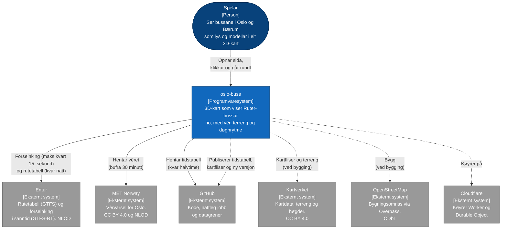
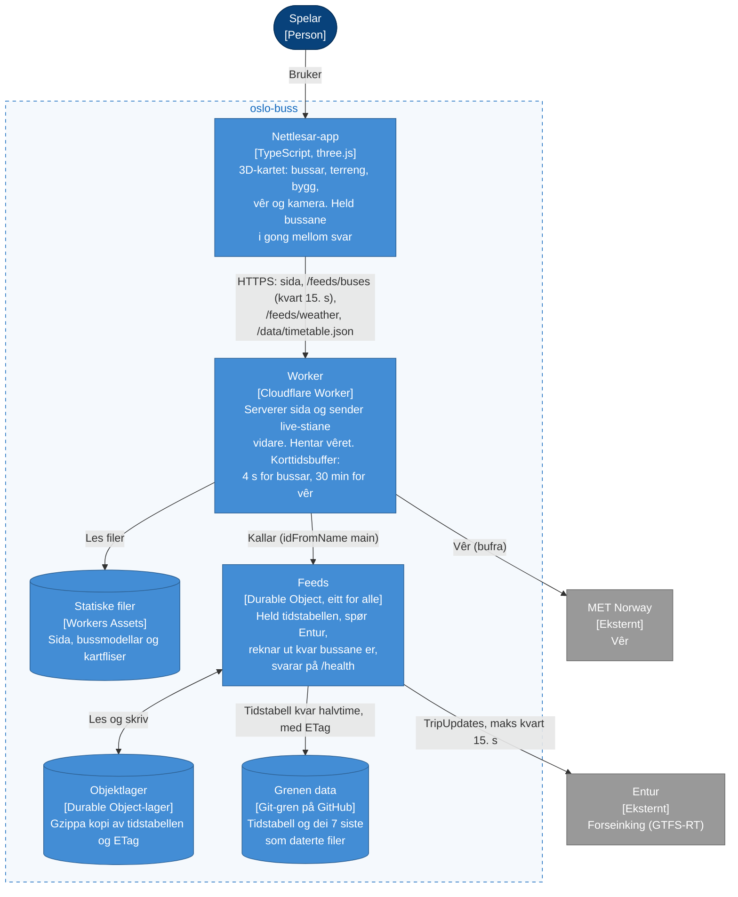
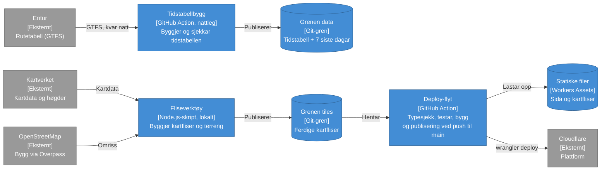

# Arkitektur

Diagram i [C4-modellen](https://c4model.com) på nivå 1 (kontekst) og nivå 2 (containerar), skrivne som Mermaid så dei vises rett på GitHub og følgjer endringar i git.
Dei viser korleis det er i dag. Kvifor det er slik står i [ADR-ane](adr/README.md), og kva som skjer når noko svikter står i [DRIFT.md](DRIFT.md).

Nivå 3 (komponentar) er ikkje teke med: koden er liten nok til at han ikkje gir meir enn han kostar å halde ved like.

**Teikn:** blå boksar er systemet vårt, grå er andre system, og sylindrar er stader der data ligg. Piler viser kven som kallar kven. På nivå 1 er stipla piler noko som skjer ved bygging eller publisering, ikkje når nokon brukar sida; på nivå 2 har bygginga eit eige diagram.

## Nivå 1: systemkontekst

Kven brukar systemet, og kva andre system er det avhengig av?

## Nivå 2: containerar

Kva er dei køyrbare delane inne i systemet, og korleis snakkar dei saman? «Container» tyder her ein del som køyrer eller held data, ikkje Docker.
Nivå 2 er delt i to diagram for å vere lesbart: det som køyrer når nokon brukar sida, og det som bygger og publiserer.

### Når nokon brukar sida

### Bygging og publisering

Ingenting av dette køyrer når nokon brukar sida. Tidstabellen blir bygd kvar natt, kartflisene for hand, og sida ved push til `main`. Her viser pilene korleis data flyttar seg.

### Kva diagrammet ikkje viser

- Kva Durable Object og Worker er i Azure-termar: sjå tabellen i [DRIFT.md](DRIFT.md).
- Kva som skjer når Entur eller GitHub svikter, og kva som er val med eit pris: [DRIFT.md](DRIFT.md) og [ADR-ane](adr/README.md).
- Kor posisjonane kjem frå: Entur gir forseinking, ikkje GPS. Utrekninga av kvar bussane er ligg i `Feeds` og i nettlesaren, sjå [ADR 0005](adr/0005-berekna-posisjonar.md).
